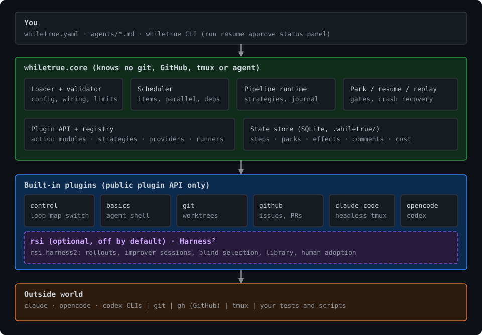
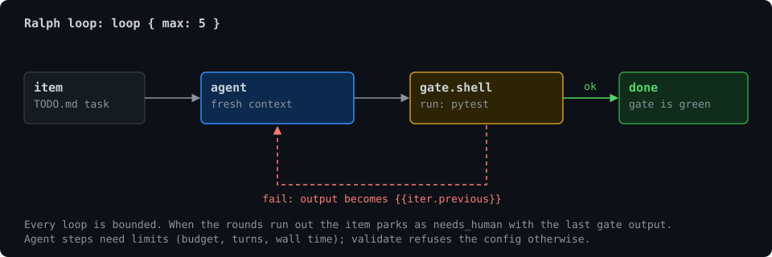
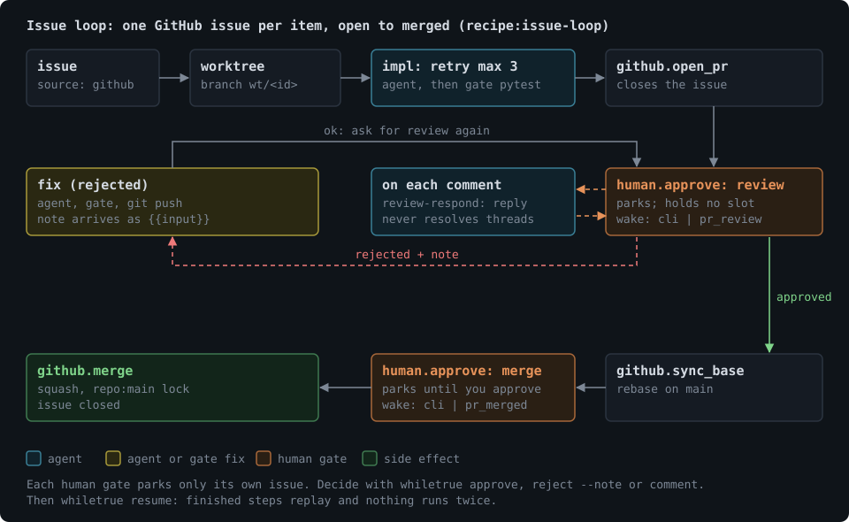

<div align="center">


# whiletrue

**The loop around your coding agents.**

Run pipelines of agentic and deterministic steps around Claude Code, opencode and Codex, locally, with gates, humans in the loop, and crash-safe resume.

[](https://pypi.org/project/whiletrue/)
[](https://pypi.org/project/whiletrue/)
[](LICENSE)
[](docs/README.md)

</div>

> LangGraph builds the agent; whiletrue runs the loop around agents you already have.

<div align="center">



<sub>A real run, not a mock-up: two Claude Code agents in parallel, a pytest gate, a human approval and a resume, about $0.23 in total. Captured from the live tmux panes; the two tmux windows are drawn side by side.</sub>

</div>

```bash
uvx whiletrue init      # scaffold a Ralph loop
uvx whiletrue run       # agent -> pytest gate -> repeat until green
```

## Overview

Coding agents are good at one task and bad at finishing a backlog unattended. whiletrue is the orchestrator you put around them. You describe the loop in a single `whiletrue.yaml`: which agent does the work, which deterministic gate checks it, when to retry, when to ask a person. whiletrue validates the config before spending a token, runs it, and records every step so you can inspect, replay or resume it.

- **Pipelines, not prompts.** Agent steps, shell and git steps, and gates compose with `sequence`, `loop`, `map`, `parallel`, `switch`, `retry`, `try` and `human.approve`. Every loop is bounded.
- **Any backend.** `claude-code-headless`, `claude-code` (the real interactive CLI in a tmux pane you can type into), `opencode` and `codex`. Mix them in one pipeline.
- **Many items at once.** One item per task or GitHub issue, each in its own git worktree, with `parallel: N` and a cap on live agent sessions.
- **Humans in the loop.** A gate parks an item until a person approves, rejects or comments; other items keep running. Every review comment gets an answer.
- **Durable.** State lives in SQLite. Kill the process at any point and `whiletrue resume` replays finished steps instead of redoing them; side effects (PRs, merges, replies) happen exactly once.
- **Local.** One machine, no server, no account. Everything is a file in your repo plus `.whiletrue/`.

## Contents

- [Install](#install)
- [Quickstart](#quickstart)
- [Architecture](#architecture)
- [Concepts](#concepts)
- [Examples](#examples)
- [Backends](#backends)
- [CLI](#cli)
- [Documentation](#documentation)
- [Development](#development)
- [License](#license)

## Install

Requires Python 3.12+ and at least one agent CLI on your `PATH` ([Claude Code](https://claude.com/claude-code), [opencode](https://opencode.ai) or [Codex](https://github.com/openai/codex)). `git` is needed for worktrees, `tmux` for interactive agents, and `gh` for the GitHub integration.

```bash
uv tool install whiletrue     # or: pip install whiletrue
whiletrue --help

uvx whiletrue --help          # or run it without installing
```

If an agent CLI is not on `PATH`, set `WHILETRUE_CLAUDE_BIN`, `WHILETRUE_OPENCODE_BIN` or `WHILETRUE_CODEX_BIN`.

## Quickstart

```bash
cd my-project
whiletrue init        # writes whiletrue.yaml and agents/ralph.md
whiletrue validate    # config, wiring, limits and safety rules; spends nothing
whiletrue plan        # prints the expanded step tree; spends nothing
whiletrue run         # runs it
whiletrue status      # steps, outcomes and cost of the latest run
```

The scaffold is a Ralph loop. The agent runs in a fresh context, a deterministic `pytest` gate checks the result, and the loop repeats (at most 5 times) until the gate is green:

```yaml
# whiletrue.yaml
name: ralph
pipeline:
  loop:
    max: 5            # every loop is bounded; `max: unbounded` is an explicit opt-out
    do:
      - agent: { uses: ./agents/ralph.md }
      - gate.shell: { run: "pytest" }
```

```markdown
---
# agents/ralph.md
agent: ralph
runner: claude-code-headless
permission_mode: acceptEdits
tools: [Read, Edit, Write, "Bash(pytest*)", "Bash(git *)"]
limits: { budget_usd: 2, turns: 40, wall: 20m }
---
Work through the next unfinished item in TODO.md. Make the tests pass.

Failure output from the previous attempt (empty on the first try):
{{iter.previous}}
```

Every agent must declare `limits`; `validate` refuses the config otherwise.

## Architecture



The core knows nothing about git, GitHub, tmux or any agent. Every integration is a plugin built on the public plugin API, so you can add your own ([plugins](docs/plugins.md), [architecture](docs/architecture.md)).

## Concepts

| Concept | What it is |
| --- | --- |
| **Pipeline** | A list of steps, or one strategy, in `whiletrue.yaml`. |
| **Step** | An action: `agent`, a shell command, a git or GitHub operation, a gate. Pure, deterministic, agentic or side-effecting. |
| **Strategy** | Control flow over steps: `sequence`, `tap`, `loop`, `map`, `parallel`, `switch`, `retry`, `try`, `human.approve`. |
| **Outcome ports** | Every step ends on `ok`, `fail`, `needs_human`, `skip` or `rejected`. `wires:` routes a port to another step; back-wires make loops. |
| **Item** | One unit of work from a `source:` (`json`, `markdown_tasks`, `github_issues`). Items run in parallel, in dependency order. |
| **Workspace** | Per-item checkout: `git-worktree`, `dir-copy` or `none`. |
| **Gate** | A deterministic check, or a human decision, that an item must pass. |
| **Recipe** | A ready-made composite: `ralph`, `review-pass`, `review-respond`, `issue-loop`. |
| **Run record** | The SQLite log of steps, parks, effects, comments and cost that makes replay and resume possible. |

Details: [reference](docs/reference.md), [authoring guide](docs/authoring.md), [architecture](docs/architecture.md).

## Examples

### A Ralph loop



This is what `whiletrue init` scaffolds. See the YAML under [Quickstart](#quickstart).

### Review loop with a read-only reviewer

```yaml
pipeline:
  composite:
    uses: "recipe:review-pass"
    params: { reviewer: ./agents/review.md, fixer: ./agents/fix.md, max_rounds: 3 }
```

### A backlog in parallel worktrees

```yaml
parallel: 4
max_agents: 4
source: { markdown_tasks: { path: TASKS.md } }   # - [ ] Title {#id after=other}
workspace: { git-worktree: { branch: "wt/{{item.id}}" } }
pipeline:
  loop:
    max: 5
    do:
      - agent: { uses: ./agents/implement.md }
      - gate.shell: { run: "pytest" }
```

### A human gate on a pull request

```yaml
- id: review
  human.approve:
    what: pr
    wake: { any: [cli, { github.pr_review: any }] }
  do:
    - composite: { uses: "recipe:review-respond", params: { responder: ./agents/respond.md } }
  wires: { rejected: fix }
```

```bash
whiletrue run                         # parks at the gate and exits with code 2
whiletrue status                      # lists what is waiting
whiletrue approve 12                  # or: reject 12 --note "what to change"
whiletrue resume                      # finished steps are replayed, never redone
```

### The reference pipeline: issues with a human in the loop

[`examples/issue-loop`](examples/issue-loop/README.md) takes every issue in a GitHub milestone from open to merged: implement in a worktree, run the gate, open a PR, answer review comments, merge, close. You review every PR, and every comment you leave gets an answer.



## Backends

Choose per agent with `runner:`.

| Runner | Runs | Notes |
| --- | --- | --- |
| `claude-code-headless` | `claude -p` | Default. Budget, turns and wall limits enforced. |
| `claude-code` | Interactive Claude Code in a tmux pane | Watch it, type into it (recorded as a *steer*). Submits through a bundled MCP tool and hooks. |
| `opencode` | `opencode run` | Structured output checked against the step's cap. |
| `codex` | `codex exec` | Sandbox derived from `permission_mode`. No budget enforcement. |

Structured `outputs:` work on all of them. See [choosing a backend](docs/authoring.md#choosing-a-backend).

## CLI

| Command | Purpose |
| --- | --- |
| `init`, `validate`, `plan` | Scaffold, check and preview a pipeline without spending tokens. |
| `run`, `resume`, `rerun`, `cancel` | Start, continue after a park or crash, redo, or stop items. |
| `status`, `logs`, `cost`, `replay` | Inspect runs, steps and spend; replay a recorded run. |
| `approve`, `reject`, `comment` | Decide human gates and talk to waiting items. |
| `attach`, `panel` | Open the tmux session and the live control panel. |
| `history`, `learnings` | Audit trail and approved lessons for future agents. |
| `lock` | Show or clear the run lock. |

Full reference: [docs/cli.md](docs/cli.md). New here? Follow the [tutorial](docs/tutorial.md).

## Documentation

Start at [docs/README.md](docs/README.md).

- [Tutorial](docs/tutorial.md): from an empty folder to your own loop with gates, a reviewer, parallel tasks and a human approval.
- [Getting started](docs/getting-started.md): a longer walkthrough, including interactive agents, gates and parallel items.
- [Authoring guide](docs/authoring.md): writing pipelines and agents.
- [Reference](docs/reference.md): every module, strategy, provider and config key.
- [CLI](docs/cli.md) and [plugins](docs/plugins.md): the command line and extending whiletrue.
- [Architecture](docs/architecture.md), [plan](docs/plan.md), [todo](docs/todo.md) and [changelog](CHANGELOG.md).

## Development

Requires [devenv](https://devenv.sh) (or Python 3.12 + [uv](https://docs.astral.sh/uv/)). See [developing.md](docs/developing.md).

```bash
git clone https://github.com/dariussingh/whiletrue && cd whiletrue
direnv allow            # or: devenv shell
poe check               # format check, lint, pyright, tests + coverage, docs check
whiletrue --help        # installed editable into .devenv/state/venv
```

Live tests against real agent CLIs are opt-in: `WHILETRUE_LIVE=1 uv run pytest tests/live -v`.

## License

MIT. See [LICENSE](LICENSE).
