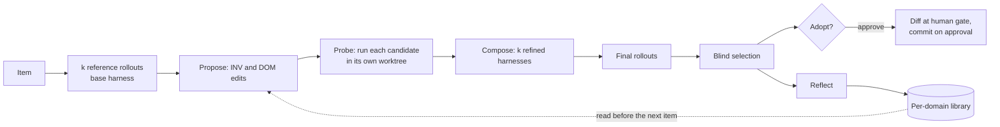

# whiletrue Architecture

> **Implementation note:** the source doc sketches a TypeScript monorepo (`@whiletrue/*`). The implementation is **Python** (3.12+), one `whiletrue` distribution on PyPI with `whiletrue.<package>` subpackages. The design below is language-neutral; interface sketches are in Python. The CLI binary is `whiletrue`. What is implemented so far (modules, control flow, expressions, composites, recipes, replay) is documented as a user reference in [reference.md](reference.md).

> Source of truth: the "whiletrue Architecture" Claude doc (rev 18, 2026-10-15). Diagrams live there; this file is the repo copy. Keep both in sync.

## Overview

whiletrue is a local, single-machine Python orchestrator that runs configurable pipelines of agentic and deterministic steps around coding agents like Claude Code and opencode. It runs outside Claude Code and drives it as a subprocess.

Positioning: **LangGraph builds the agent; whiletrue runs the loop around agents you already have.** Fixed-pipeline tools such as ralphex, and persona tools such as ralph-orchestrator, let you tune their steps. whiletrue lets you change the shape of the loop itself.

### What sets it apart

- **Accountable human gates.** Human review is a first-class, durable step with an audit trail. Every comment you leave gets an answer from the pipeline, and all of it becomes project memory.
- **Composable loops.** Every module is a GStreamer-style element with typed ports. A loop is just a composite module, and composites nest.
- **Live, interactive agents.** Each running agent is a real Claude Code session in a tmux pane that you can type into at any time.
- **Shareable, testable loop recipes.** Pipelines and composites are files you can version, import, validate and replay.

### Non-negotiables (from the author's workflow)

1. The human keeps both high-level and low-level context of the project.
2. Code has maximal test coverage.
3. User docs and architecture docs stay current.
4. The human is accountable for every line shipped: AI writes the code, the human verifies it.

### Design principles

1. **State on disk, fresh context by choice.** Run state lives in SQLite, and how much context an agent carries is a per-step setting.
2. **Gates are deterministic.** A gate is code with an exit code. An agent can never grade itself.
3. **Bounded by default.** Every loop has a maximum, and every agent step has limits. Unbounded `while true` must be opted into explicitly.
4. **Validate before spending.** Wiring, types and config are checked before any tokens are spent.
5. **Core stays small.** Built-in modules use the same public plugin API as third-party ones.
6. **No hard dependency on git or GitHub.** Sources, sinks and workspaces are plugins.

## Core model

Everything is a **module**. A module is either an **action**, which does one thing, or a **composite**, which holds child modules and a **strategy** for running them. A loop is a composite whose strategy is `loop`, so loops nest to any depth.

> *[Diagram in the source doc: how the parts fit together · runtime, pipeline, runners, tmux]*

The runtime pulls items from sources, runs each one through the module tree, and records everything in SQLite. Agent steps go through a runner into a tmux pane, and live Claude sessions report back through the whiletrue plugin.

There are four extension points, each a plugin interface:

| Extension point | Answers | Examples |
|---|---|---|
| Action module | What does this step do? | `shell`, `gate.tests`, `gate.diff_size`, `git.commit`, `github.open_pr`, `agent`, `classify`, `human.approve`, `context.reset` |
| Strategy | How does a composite run its children? | `sequence`, `loop`, `map`, `parallel`, `switch`, `retry`, `try` |
| Runner | How is an agent invoked? | `claude-code` (interactive, in tmux), `claude-code-headless`, `opencode` |
| Provider | Where do items, state and workspaces come from? | sources (`github_issues`, `json`, `markdown_tasks`), stores (`sqlite`), workspaces (`git-worktree`, `dir-copy`, `none`), knowledge (`spec-dir`) |

### Ports and caps

Modules connect through **typed ports**, as GStreamer elements connect through pads.

- Every module has a default `in` and `out` data port, and may declare more.
- Every module has **outcome ports**: `ok`, `fail`, `needs_human`, `skip`, and optionally `rejected`. A port that isn't wired falls back to the composite's policy, for example "park on `fail`".
- **Caps** are schemas on ports: `Issue`, `Diff`, `PullRequest`, `Verdict`, `ReviewFindings`, `Text`, `Any`. They are JSON Schema, authored as pydantic models.
- Inside a `sequence`, `out → in` is wired automatically. Explicit `wires:` are needed only for fan-out, routing or skipping.
- `whiletrue validate` checks that every wire connects compatible caps. At runtime, agent outputs are validated against their port's caps before they move on.

### Module interface (sketch)

```python
@dataclass
class ActionModule[Cfg: BaseModel]:
    id: str  # 'gate.tests'
    config: type[Cfg]  # pydantic model
    ports: Ports  # inputs / outputs, caps per port
    effects: Literal["pure", "deterministic", "agentic", "side-effect"]
    run: Callable[[PortValues, StepContext[Cfg]], Awaitable[Emit]]
    capabilities: list[str] = []  # e.g. 'needs-workspace', 'needs-session'
    validate: Callable[[Cfg, ValidateContext], list[ConfigIssue]] | None = None
    idempotency_key: Callable[[PortValues, StepContext[Cfg]], str] | None = None


@dataclass
class Strategy[Cfg: BaseModel]:
    id: str  # 'loop'
    config: type[Cfg]  # until, max, over, parallel ...
    run: Callable[[list[PipelineNode], PortValues, CompositeContext[Cfg]], Awaitable[Emit]]
    chain: bool = False  # children's out -> next in
    validate: Callable[[Cfg, ValidateContext], list[ConfigIssue]] | None = None


@dataclass
class Emit:  # which port fires, with what
    port: str
    value: Any = None
```

- `effects` drives the safety rules. Gates must be `deterministic`, `side-effect` modules must journal their work, and `pure` and `deterministic` results can be cached by input hash.
- `StepContext` provides config, scoped key-value context, the workspace, sessions, the event bus, the logger and a cancellation signal.
- A strategy runs children only through `ctx.run(child, input)`, so the runtime sees and records every execution.

### Scoped context and resources

Alongside data on ports, each composite has a **scope**. It holds key-value context inherited by its children (`item`, `repo`, `milestone`, `steps.<id>.output`) and owns **resources**: workspaces, agent sessions and tmux panes. A resource is released when its scope exits. That makes "one worktree per issue" or "one Claude session per issue" a matter of where you declare it.

## Pipeline config and authoring

There are four authoring layers, each a step deeper than the last. Most users stay in the first two.

| Layer | Format | Use it for |
|---|---|---|
| Pipelines | YAML | Composing modules into a loop you run |
| Composites | YAML with declared ports and params | Reusable, shareable sub-loops such as `review-pass` or `ralph`, imported with `uses:` |
| Agent modules | Markdown with frontmatter | A prompt-defined agent step: runner, model, tools, permissions, and input and output caps |
| Plugins | Python (PyPI, entry points) | New actions, strategies, runners, sources, stores and workspaces |

The `exec` module is an escape hatch: it runs any executable that speaks JSON over stdin and stdout, so a module can be written in any language.

### Composite example

```yaml
# loops/review-pass.yaml
composite: review-pass
params: { runner: opencode, kinds: [architecture, code, tests] }
ports:
  in:  { pr: PullRequest }
  out: { findings: ReviewFindings }
strategy: { loop: { over: "{{params.kinds}}", collect: findings } }
do:
  - agent: { uses: ./agents/review.md, runner: "{{params.runner}}", vars: { kind: "{{iter.value}}" } }
```

### Agent module example

```markdown
---
agent: implement
runner: claude-code
model: opus
session: item            # fresh | item | <named>
tools: [Read, Edit, Write, "Bash(make test*)", "Bash(git *)"]
permission_mode: acceptEdits
inputs:  { issue: Issue }
outputs: { result: ImplementResult }   # enforced through whiletrue_submit
context: { knowledge: "{{issue.spec_refs}}", learnings: run, history: item }
limits:  { budget_usd: 8, turns: 120, wall: 90m }
---
Implement {{issue.title}} using TDD. Write failing tests first...
```

### Predictability guardrails

- **`whiletrue plan`** parses the config, resolves every module and plugin, type-checks every wire, and prints the expanded tree. Nothing runs and no tokens are spent.
- **Lockfile.** `whiletrue.lock` pins plugin versions. Each run records hashes of the pipeline, composite and prompt files it used.
- **Effects rules.** Gates must be deterministic, and side-effect modules must provide an idempotency key.
- **Bounds.** `loop` requires `max` (or an explicit `max: unbounded`), and agent steps need `limits`.
- **Record and replay.** Agent outputs are stored, so `whiletrue replay <run>` re-runs the pipeline logic against them without calling any model.

## Runtime

The runtime is an **item-token scheduler**. Each work item, such as an issue, travels through the pipeline as its own token. A human gate parks one token without stopping the run, and other runnable items keep going.

### Item lifecycle

An item is in exactly one state at a time:

| State | Meaning |
|---|---|
| `pending` | Known, but its dependencies aren't done yet |
| `ready` | Its dependencies are done, and it's waiting for a free slot |
| `running` | A step is executing, and it holds a slot and its resources |
| `parked` | Waiting on a wake condition: a human gate, retries exhausted, or a takeover. It holds no slot |
| `done` | Exited the pipeline through `ok` |
| `failed` | Exited through `fail` with an `on_fail: drop` policy |
| `cancelled` | Removed upstream, for example an issue closed by hand, or cancelled by a user command |

### Dependency graph

- `depends_on` is a **core** concept, not a GitHub feature. Any source can supply edges: GitHub "blocked by" links, a `depends_on` field in JSON, or task references in markdown.
- The scheduler keeps the item graph and moves an item to `ready` only when every dependency is `done`. Cycles are rejected at plan time.
- Dependents of a parked or failed item stay `pending`, and the status view shows why.

### Concurrency

- `map: { parallel: N }` caps concurrent items. A global `max_agents` caps live agent sessions across the whole run.
- Resource locks, such as `repo:main` for merges, serialize steps that must not race.

### Parking and waking

- A parked step records a **wake condition**: `cli` (`whiletrue approve` or `whiletrue reject`), `github.pr_review: approved`, `github.pr_merged`, `file_exists`, `timer`, or any plugin check.
- `whiletrue resume` (or the watcher) re-evaluates wake conditions. A woken item continues from the parked step and fires that step's `ok` or `rejected` port.
- `on_idle: exit | watch` decides what happens when only parked items remain. `exit` is the default and prints a summary of what's parked and why. `watch` polls at an interval.

### Failure policy

- `retry` wraps any module: `retry: { max: 3, backoff: 30s, feedback: true }`. With `feedback`, the failure output (the test log, for example) is passed into the next attempt.
- When an item runs out of retries, the default is to **park it as `needs_human`** with the failure log attached. Its dependents stay blocked, and other items continue.
- A crash leaves the store consistent. On restart, steps that were `running` are recovered: side-effect steps are checked against the journal, and agent steps are re-attached or re-run according to their policy.

## State

A local SQLite database (`.whiletrue/state.db`) is the runtime source of truth. GitHub, git and every other system are optional integrations behind plugin interfaces.

### Two kinds of truth

- **External systems own the items.** Whether an item exists and its upstream status (open, closed, its labels, its dependencies) come from the source. They are re-synced at run start, on resume, and before an item becomes `ready`.
- **SQLite owns pipeline progress.** Which step an item is on, its outputs, its retries, its parked gates and its sessions live only in the store.
- When the two conflict, for example an issue closed by hand mid-run, the source wins. The item becomes `cancelled`, its resources are released, and an event records why.

### Store tables (v1 sketch)

| Table | Holds |
|---|---|
| `runs` | Run id, pipeline hash, lockfile, start and end, status |
| `items` | Item id, source key, state, payload snapshot, `depends_on` |
| `steps` | One row per step execution: item, node path, attempt, status, input and output, cost, timings |
| `parks` | Parked steps: wake condition, reason, notes, who approved or rejected it and when |
| `sessions` | Agent sessions: runner, session id, scope, tmux pane, status |
| `effects` | Side-effect journal: idempotency key, status, external ref (PR URL, commit SHA) |
| `learnings` | Run, pipeline and project learnings with their provenance |
| `events` | Append-only event log: every started, output, cost, error, approval and takeover |
| `cache` | Cached results of pure and deterministic modules, keyed by input hash |

The store is behind a `StateStore` interface. SQLite is the only v1 backend, and a JSON-file backend can come later for tests or very small setups.

### Human input history

Comments are first-class pipeline memory. They are human input, just like steers, approvals, git history and docs, and later steps and later items need to see them.

| Record | What is stored | Captured from |
|---|---|---|
| `comments` | Thread, author, body, classification, the agent's reply, status (open, answered, resolved), linked commit | Comments providers: GitHub PR threads, `whiletrue comment` |
| `steers` | Session, step, what you typed, when | The `UserPromptSubmit` hook in interactive panes |
| `parks` | Approvals and rejections, with notes | Human gates |
| Git and docs | Commit refs and doc paths, linked rather than copied | Workspace and knowledge providers |

- Agents read this history through `context.history`, scoped to the item (the default), the run, or the project. They can also fetch it on demand with `whiletrue_context()`.
- `whiletrue history <item>` prints one timeline that interleaves comments, replies, steers, approvals and commits.
- An optional `history.distill` step runs when an item finishes. It turns recurring feedback, such as "always add an integration test for new CLI flags", into proposed project learnings, each linked to the comments it came from. You approve them before they are injected into future runs.

### Side-effect journal

Before a side effect such as a push, opening a PR or posting a comment, the module writes an `effects` row with a deterministic idempotency key, for example `pr:<run>:<item>`. After the external call, it writes the external ref. On resume, an existing key with a ref means **skip and reuse**. An existing key without a ref means **look it up first** ("is there already a PR for this branch?"). Resuming never creates a second PR.

### Resume

`whiletrue resume [run]` re-syncs sources, recovers interrupted steps, re-evaluates wake conditions and continues. A finished step is never re-run unless you ask with `whiletrue rerun <item> --from <step>`.

## Agents and runners

By default, each Claude Code agent step runs as a **real interactive `claude` session in its own tmux pane**. The structure that headless mode would normally provide comes instead from a bundled whiletrue Claude Code plugin: an MCP server for typed results, and hooks for lifecycle events.

### The interactive runner

whiletrue starts each session as `claude "<rendered prompt>"` inside a tmux pane. The prompt goes in as an argument, so no keystrokes are ever sent. Per-step flags come from the agent module:

| Module setting | Claude Code flag |
|---|---|
| Session identity | `--session-id <uuid>`, or `--resume <id>` (plus `--fork-session`) for `session: item` |
| Model | `--model` |
| Tools and permissions | `--tools`, `--allowedTools`, `--disallowedTools`, `--permission-mode` |
| Context | `--append-system-prompt-file`, `--add-dir`, `--mcp-config` |
| whiletrue plugin | `--plugin-dir <bundled plugin>` |
| Reproducible mode (`bare: true`) | `--bare` |

Several headless-only flags (`--json-schema`, `--max-turns`, `--max-budget-usd` and `--permission-prompts`) don't apply to interactive sessions, so whiletrue provides each of these behaviors itself.

### The whiletrue plugin inside each session

- **MCP tools:**
      - `whiletrue_submit(result)` is how an agent finishes a step. The result is validated against the step's output caps. An invalid result returns the schema errors so the agent can fix it.
      - `whiletrue_learn(note)` appends to the learnings store.
      - `whiletrue_ask(question)` parks the step as `needs_human`.
      - `whiletrue_context()` returns item, spec and learnings context on demand.
- **Hooks**, which post events to the local whiletrue process:
      - `SessionStart` binds the session to its step.
      - `PostToolUse` records tool calls for the event log, cost and turn counts.
      - `UserPromptSubmit` marks the step as human-steered. It records the input as a steer event and lifts the step's limits.
      - `Notification` (permission or idle prompts) flags the pane as needing you.
      - `Stop` checks whether a result was submitted. If not, it blocks the stop and nudges the agent to call `whiletrue_submit`, up to N times, then parks the step.
      - `SessionEnd` cleans up.

### Limits without headless flags

- **Turns and wall time** are counted from hook events and enforced by whiletrue.
- **Budget** is estimated from the session transcript's usage. When it's exceeded, a `PreToolUse` hook denies further tool calls and the step parks with `budget_exceeded`. This is softer than `--max-budget-usd` and will be documented as an estimate.
- **Permission prompts** don't hang the run. They show in the pane and are flagged in the status view, so you can answer them.

**Human steering lifts the limits.** Once you type into a session, that step's budget, turn and wall-time limits are dropped for the rest of the step, because you are driving it now. Cost is still recorded, split into agent-only and steered spend. The step's gates still run before the item moves on.

### Other runners

- **`claude-code-headless`** uses `claude -p --output-format stream-json`, with `--json-schema`, `--max-turns`, `--max-budget-usd` and `--permission-prompts none`. It's for unattended runs, CI and cheap utility steps. Its pane shows a read-only live render.
- **`opencode`** is a subprocess runner for review passes.
- Every runner declares its capabilities (`interactive`, `structured_output`, `resume`, `fork`, `budget`), and `validate` rejects a step that asks for something its runner can't do.

### Sessions and memory

| Option | Behavior |
|---|---|
| `session: fresh` | A new session for this step (Ralph-style) |
| `session: item` | One session shared by every step of the same item that asks for it, such as implement and fix-after-review |
| `session: <name>` | A named session shared within its declared scope |
| `fork: true` | Branches from the shared session without changing it |
| `context.knowledge` | Injects spec files or line ranges (`specs/m3/api.md#L40-L88`) through a knowledge provider |
| `context.learnings` | Injects learnings scoped to `run`, `pipeline` or `project`. New ones come only through `whiletrue_learn`, with provenance |
| `session.end` / `context.reset` modules | Explicitly close a session or drop context mid-pipeline |

By default, a session loads the project's own CLAUDE.md, skills and hooks, plus the whiletrue plugin, with tools limited to what the module declares.

## Human gates and the TUI

Human gates park one item and never block the run. The TUI is a tmux session: one window holds the control panel, and every live agent session gets a pane you can type into.

### Gates

```yaml
- human.approve:
    what: pr                      # shown in status and the control panel
    show: "{{steps.pr.output.url}}"
    wake: { any: [cli, { github.pr_review: approved }] }
  do:                             # runs when new comments arrive, then the gate parks again
    - composite: { uses: "recipe:review-respond", params: { responder: ./agents/respond.md } }
  wires: { rejected: fix }        # the rejected port carries your note
```

- `whiletrue approve <item> [--note]` fires `ok`.
- `whiletrue reject <item> --note "..."` fires `rejected`, carrying your note as the payload. Wire `rejected` into a fix step, and your review comments become the next agent's input.
- An external wake condition, such as a GitHub PR approval, fires `ok` on its own. A changes-requested review can map to `rejected`, with the review comments as the payload.
- Every decision is written to `parks` and `events`: who decided, when, the note, and the item's state at that moment. That audit trail is what backs your accountability rule.

### Every comment gets an answer

A human gate is a conversation, not a silent wait. While the gate is parked, each new comment on the item wakes a **respond** step, and then the gate parks again. A comment can be a PR review comment, a reply in a thread, or `whiletrue comment <item> "..."`. The gate closes only on approval or rejection.

The same `review.respond` composite answers human comments and AI review comments, such as the opencode passes:

1. **Collect** unanswered comments from the comments provider (GitHub PR threads, or local comments from the CLI). Each one is a `Comment` cap.
2. **Classify** each comment as a question, a change request, a nit, an approval, or out of scope.
3. **Act on it.** A question gets an answer. A change request gets a fix (agent, gates, push). A nit is fixed, or declined with a reason. Anything out of scope becomes a proposed follow-up issue, which you confirm.
4. **Reply in the same thread** and say what happened: the answer, "fixed in `abc123`", or "declined because ...". Each reply is a journaled side effect, so a comment is never answered twice.
5. **Check.** `gate.comments_answered` is a deterministic gate that fails while any human or reviewer comment still has no reply.

The rules:

- The agent replies but never resolves a human's thread. Resolving is yours.
- Agent replies are marked as coming from whiletrue, for example with a `[whiletrue]` prefix, so you always know who wrote what.
- When the agent can't answer, for example a design decision or missing context, it says so in the thread and the item stays parked as `needs_human`.

### tmux layout

- Window 0 is the **control panel**: a table of items with their state, current step, park reason, cost and age, plus keys to approve, reject, focus a pane, rerun, or cancel an item.
- Each live agent session is a **pane** running real interactive Claude Code, titled `#142 implement` with the step and a cost badge. You can type into any pane at any time. whiletrue records it as a steer and drops that step's limits, but the step's gates still run before the item moves on.
- Panes are laid out in a grid. New windows open when a window is full (four panes by default), and a pane closes or stays open when its step ends, following `on_done: close | keep`.
- Headless steps such as opencode reviews get read-only panes that show the live stream.
- `whiletrue attach` reattaches to the tmux session after you detach or close the terminal. The run keeps going without a terminal attached.

### Observability outside tmux

- `whiletrue status` prints the same table as the control panel.
- `whiletrue logs <item> [--follow]` prints the event log for an item.
- `whiletrue cost [run]` breaks cost down by item, step and runner.

## Reference pipeline: the issue loop

The v0.1 acceptance test is the author's workflow, steps 8 to 11, running end to end on a real milestone with parallel items. Steps 1 to 7 (design, specs, writing issues) stay human-led for now.

```yaml
# whiletrue.yaml
name: milestone-loop
uses: [whiletrue.github, whiletrue.git, whiletrue.opencode]
on_idle: exit

source:
  github_issues: { milestone: M3, state: open, depends_on: blocked_by }
comments:
  github_pr: {}                    # plus local `whiletrue comment` by default

pipeline:
  map:
    parallel: 4
    workspace: { git-worktree: { branch: "wt/{{item.number}}" } }
    do:
      - id: impl
        retry: { max: 3, feedback: true }
        do:
          - agent: { uses: ./agents/implement.md, session: item }
          - gate.shell: { run: "make test && make coverage-check" }
          - gate.shell: { run: "make docs-check" }
          - gate.diff_size: { max_lines: 700 }
      - git.commit_push: {}
      - id: pr
        github.open_pr: { closes: "{{item.number}}" }

      - id: my_review              # non-negotiable 4: the human reads every PR
        human.approve:
          what: pr
          wake: { any: [cli, { github.pr_review: approved }] }
        do:                            # every question and comment gets a reply
          - composite: { uses: "recipe:review-respond", params: { responder: ./agents/respond.md } }
        wires: { rejected: fix }

      - id: ai_review
        uses: ./loops/review-pass.yaml   # architecture, code and tests, via opencode
        with: { runner: opencode, post_as: comments }

      - id: fix                    # answers AI review comments and your rejection notes
        loop:
          max: 3
          until: "{{steps.fix.output.unanswered == 0}}"
          do:
            - uses: "whiletrue.recipes/review-respond"   # classify, fix, reply per thread
              with: { session: item }
            - gate.shell: { run: "make test" }
            - gate.comments_answered: {}

      - github.sync_base: { strategy: rebase }   # resolves conflicts or parks
      - human.approve: { what: merge, wake: { any: [cli] } }
      - github.merge: { lock: "repo:main" }
      - history.distill: { propose_learnings: true }
```

The pipeline exercises every core feature: the item graph, parallel worktrees, retry with feedback, deterministic gates, a side-effect journal (push and PR), a conversational human gate that answers every comment, with a `rejected` route, a nested loop, a reusable composite, a second runner, a shared session across steps, and a resource lock for merges.

## Recursive harness improvement (RSI)

**Status: planned (M5), off by default.** Source method: Harness² (Xu et al., Google Research, 2026, [arXiv:2610.14224](https://arxiv.org/abs/2610.14224), [code](https://github.com/google-research/harness2), Apache-2.0). The method code is ported into this repo as `whiletrue.rsi.harness2` (Apache-2.0 headers kept; see [THIRD_PARTY_NOTICES.md](../THIRD_PARTY_NOTICES.md)). Other RSI methods can sit beside it as `whiletrue.rsi.<method>`; `rsi.method` selects one (default `harness2`).

A pipeline normally runs the same agent harness (the agent file, plus the project's `CLAUDE.md`, skills, subagents, hooks and scripts) for every item. With `rsi: true`, whiletrue improves that harness while the backlog runs, keeping model weights fixed. It works at two levels.

- **Task-level recursion** refines the harness for the current item with a contrastive **Propose, Probe, Compose** step. Reference rollouts of the base harness give evidence. An improver proposes general (invariant, INV) and domain-specific (DOM) edits. Each candidate is probed by running it on the same item. Compositions combine the candidates using the behavioral contrasts between their rollouts. A blind selector, which never sees scores, picks one final output.
- **Harnessing-level recursion** keeps what worked. After an item, a reflector stores the adopted harness and evidence-supported lessons in a per-domain library that later items read.



### Setting

```yaml
rsi: false                  # default; every existing config behaves exactly as before

agents:                     # or per agent file: `rsi:` in the header
  rsi:
    k: 1                    # task-level recursion budget
    mode: parallel          # parallel | sequential
    domain: "item.labels[0]"   # expression; default is the source label or project
    adopt: approve          # approve (default) | auto | never
    evidence: blind         # blind (default) | gates
    budget_usd: 12          # required; hard cap, parks the item when reached
    when: "iter.index > 1"  # optional guard
```

`whiletrue run --rsi` and `--no-rsi` override the file. `validate` refuses `rsi` without a budget, without limits on the improver and selector agents, without `workspace: git-worktree`, or without an adoption policy. `plan` prints the RSI stages and the worst-case cost: one step at `k` is **R = 4k rollouts and P = 3k improvement sessions**, so `k: 1` costs about 7 times a plain agent run.

### How it maps onto whiletrue

| Harness² | whiletrue |
|---|---|
| Task, domain, task stream | Item, `rsi.domain`, item order |
| Base harness | The agent file and the project's agent surface in the item's worktree |
| Rollout | The pipeline's agent step run under a harness, in an isolated worktree |
| Executor | A runner: `claude-code-headless`, `claude-code`, `opencode`, `codex`, 
| Improver, composer, selector, reflector | Ordinary whiletrue agent steps with limits, on any backend |
| c1..c8 component tree | A `SurfaceSpec` per runner: system prompt, guardrails, memory, tool guidance, subagents, skills, scripts, plugins |
| Budget ledger | `cost`, split by stage, with a hard `budget_usd` |
| Experience library | `.whiletrue/rsi/`, linked to `history` and `learnings` |

### Principles

1. **Off unless asked.** `rsi: false` is the default and leaves behavior unchanged. This is regression-tested.
2. **Answer-free by default.** Evidence and selection never contain a verifier's verdict, as in the paper. A coding pipeline already has deterministic gates, so `evidence: gates` and `selection: gate-first` are opt-in (OQ-12).
3. **A human adopts.** Candidate harnesses live in worktrees. Adopting one into the repo is a diff at a `human.approve` gate. Hooks, scripts and permission rules are never adopted automatically, because they execute code.
4. **Bounded.** A required budget, the `4k` and `3k` identity checked at run time, and a `when:` guard.
5. **Resumable.** Rollouts are journaled; a finished rollout is reused through its completion marker and harness fingerprint.
6. **Core stays clean.** `whiletrue.rsi` is a plugin on the public API. `whiletrue.core` imports nothing from it.

### What is taken from Harness²

Only method code (`core/`: component tree, spec seam, ledger, library, selection, run markers, evidence context, prompts), ported and refactored into `whiletrue/rsi/harness2/` with the upstream headers kept, modifications noted, and each file listed in `third_party/harness2/PROVENANCE.md`. The orchestration is rebuilt on whiletrue's runtime. Benchmark runners, patches and datasets are not taken; they keep their upstream licenses, and the WorkBuddy-derived code carries a territorial limitation. whiletrue is an independent project and is not affiliated with Google or the Harness² authors.

## Packages and repo layout

One Python distribution, `whiletrue`, published to PyPI. Each row below is a subpackage (`whiletrue.<name>`); the core has no knowledge of git, GitHub, tmux or any specific agent, and that boundary is enforced by an import test. Third-party plugins are separate distributions that advertise a `Plugin` under the `whiletrue.plugins` entry-point group (or a module exposing `plugin`), and are named in `uses:`.

| Package | Contents | Depends on |
|---|---|---|
| `whiletrue.core` | Module, strategy and runner interfaces, registry, config loader, validator, scheduler, store interface, event bus | none |
| `whiletrue.store_sqlite` | SQLite `StateStore` (stdlib `sqlite3`) | core |
| `whiletrue.control` | Strategies: `sequence`, `loop`, `map`, `parallel`, `switch`, `retry`, `try` | core |
| `whiletrue.basics` | `shell`, `exec`, `agent`, `gate.*`, `human.*`, `context.*`, `session.*`, sources `json` and `markdown_tasks` | core |
| `whiletrue.claude_code` | Interactive and headless runners, plus the bundled Claude Code plugin (MCP server and hooks) | core |
| `whiletrue.opencode` | opencode runner | core |
| `whiletrue.git` | `git-worktree` workspace, commit, push, diff modules | core |
| `whiletrue.github` | `github_issues` source, PR, review, merge and wake conditions | core, git |
| `whiletrue.tmux` | TUI: session, panes, control panel | core |
| `whiletrue.cli` | The `whiletrue` command; loads plugins listed in `whiletrue.yaml` | all of the above as defaults |
| `whiletrue.recipes` | Shareable composites: `ralph`, `review-pass`, `issue-loop` | control, basics |
| `whiletrue.rsi` (planned, M5) | Optional recursive harness improvement. `whiletrue.rsi.harness2` is the Harness² method (component tree, surfaces, ledger, library, selection, evidence, prompts, `rsi.harness2` strategy, adoption gate); other methods can be added beside it | core, git |

### CLI surface (v0.1)

`whiletrue init` · `validate` · `plan` · `run` · `resume` · `status` · `attach` · `approve` · `reject` · `comment` · `history` · `rerun` · `cancel` · `logs` · `cost` · `replay`

### Project files

- `whiletrue.yaml` is the pipeline, and `whiletrue.lock` pins plugin versions.
- `agents/*.md` and `loops/*.yaml` hold the project's agent modules and composites.
- `.whiletrue/` holds `state.db`, logs and session transcripts. It is git-ignored.
- `third_party/` holds the upstream license text and provenance for code ported into this repo (today: Harness²). See [THIRD_PARTY_NOTICES.md](../THIRD_PARTY_NOTICES.md).

## Implementation status (M0 to M4)

Built and tested; user-facing detail is in [reference.md](reference.md), extension API in [plugins.md](plugins.md).

**Engine (M0).** Modules and strategies with typed ports and caps (pydantic), the outcome ports (`ok`, `fail`, `needs_human`, `skip`, `rejected`) with the `on_fail` policy, a plugin registry (entry point group `whiletrue.plugins`), strict `{{dotted.path}}` templates, a static validator, a scoped runtime that persists every step and event to a `StateStore` (SQLite or in-memory), and the headless Claude Code runner. Items run sequentially; parallel item scheduling is M3.

**Control flow (M1).** `sequence`, `loop`, `map`, `parallel`, `switch`, `retry` and `try` are strategies over `ctx.run`. Key decisions:

- *Expressions.* CEL via the Rust-backed `common-expression-language`, wrapped in `core.expr.Expr` (`parse_expr`, `check`, `eval`, `eval_bool`) so the engine can be swapped. `check` is static (unknown variables, function allow-list); full cap type-checking is not possible with the available libraries. The loop scope is `iter` because `loop` is a CEL reserved word. Rationale and the spike are in [open-questions.md](open-questions.md).
- *Wires.* `wires: {port: sibling}` is resolved in the chain runner (`control.chain.run_chain`): the emitted value is routed to the sibling and the chain continues from there; at most 1000 routes per chain.
- *Retry and park.* `retry` re-runs on `fail` only; exhaustion emits `needs_human`, which the runtime turns into a parked item. `try` converts `fail` to `skip`/`ok`.
- *Hooks for static checks.* `Strategy.validate_node(config, node, ctx)` sees the children (used by `switch` to check case targets); `Strategy.validate(config, ctx)` sees only config.
- *Gates.* `gate.*` must be `deterministic`; `gate.tests` and `gate.diff_size` ship alongside `gate.shell`.

**Composites.** A composite file declares `params` (with `default`/`required`), optional `ports` (`in`/`out` caps) and a `pipeline`. `core.composite.expand_composites` runs at load time and replaces each `composite:` step with a `sequence` node: `{{params.x}}` is substituted (a lone token keeps its type), step ids are prefixed with the composite step's id (including the sibling ids named by `switch`), nested composites are expanded recursively (cycle and depth checks), and the declared ports are attached to the node so the validator can type-check wiring around it. `recipe:<name>` resolves to YAML shipped in `whiletrue/recipes/`.

**Reproducibility.**
- *Cache.* Before running an action whose `effects` are `pure`/`deterministic` and which is `cacheable`, the runtime looks up `sha256(module id, config, input)` in `StateStore.cache_get`; only `ok` results are stored (`cache_put`). Emits `step.cached`. Disabled by `cache: false` and during replay.
- *Lock.* `whiletrue.lock` (JSON) maps plugin name to version; `Registry.use(plugin, version)` records versions; the CLI refuses to run when they drift. The run row stores a hash of the lock file.
- *Hashes.* Each run emits `run.hashes` with the pipeline hash and SHA-256s of the pipeline file, expanded composites and every file named by a step's `uses:` (prompts).
- *Replay.* `core.replay.load_recording` reads a run's steps; `run_pipeline(replay=...)` serves each recorded `(item, node, attempt) → (port, output)` for every non-`pure` action (emitting `step.replayed`) and fails the step with "Replay diverged" if the recording lacks it. Strategies and `pure` modules always run, so control flow is re-evaluated against the recorded outputs. The CLI compares the final status and item states with the recording.

**Interactive Claude Code (M2).** The design above is built as described, with these specifics (the spike that confirmed it is [spike-interactive.md](spike-interactive.md)):

- *Process layout.* `whiletrue run` starts a loopback `EventEndpoint` (token-authenticated, one handler per live pane, keyed by step key). `InteractiveRunner` writes per-step files under `.whiletrue/sessions/`, opens a pane through a `PaneHost` (`TmuxPaneHost` in the CLI) and launches `claude … -- "$(cat prompt.md)"` with `--plugin-dir` (hooks), `--mcp-config` (the `whiletrue` MCP server) and `--append-system-prompt-file`. A prompt over 100 KB is passed as a pointer to its file because one argument is capped at 128 KiB. Tool names are fixed (`mcp__whiletrue__whiletrue_submit`) because the server is passed with `--mcp-config`, not bundled in the plugin.
- *Thin clients.* The plugin's `hook.py` and `mcp_server.py` use only the standard library and hold no logic: they forward to the endpoint, which hands the call to the pane's `StepSession`. A hook can never break a session (any failure is silent).
- *`StepSession`.* Finishes a step at the first `Stop` after a successful `whiletrue_submit`; turns a `Stop` with no result into a nudge (`{"decision":"block"}`), counted by whiletrue because `stop_hook_active` stays true after the first; parks with `needs_human` after N nudges or on `whiletrue_ask`; ends with an error if the session closes without a result.
- *Limits.* `PreToolUse` denies tools once a limit is hit; the runner also parks the step if the agent keeps going (`limit_grace`) or the wall-time deadline passes. Turns are assistant messages in the transcript (deduplicated by message id); the budget is tokens × list price per model family, and an unknown model is priced as the dearest family. It is an estimate (OQ-2 stays open until measured against billing).
- *Steering.* Any `UserPromptSubmit` after the first is a steer: limits lift, nudging stops, and spend after that moment is reported as steered.
- *Sessions.* The item scope holds `sessions: {name: claude session id}`. `session: item|<name>` resumes (`--resume`), `fork: true` adds `--fork-session` without updating the stored id, and `session.end` / `context.reset` remove entries.
- *Trust prompt.* Claude Code's "trust this folder" dialog is left to the human in the pane; whiletrue does not auto-trust directories.

**Human gates, GitHub and review (M4).** Built as designed, with these specifics:

- *Park and resume.* A parked gate is a row in `parks` (keyed by item, so it can be decided from another process). `resume` is a replay that continues: `run_pipeline(replay=..., resume=True, lineage=...)` serves recorded results for every non-`pure` action except steps that fired `needs_human`, runs anything with no recording for real, and creates a new run in the same lineage. The Nth execution of a gate in a lineage uses the Nth park, which makes replays deterministic and gives a loop one park per pass. Children of a gate run with replay off (`scope no_replay`) so new comments always get live answers.
- *Side effects.* `ActionModule.journal` records a result under an effect key (`github.open_pr:o/r:wt/12`, `github.merge:o/r:1`, `reply:<item>:<source>:<comment>`); a repeat returns the recorded result. A `started` effect with no `done` (a crash mid-post) is not repeated.
- *Comments.* `CommentsProvider`s (`github_pr`, plus local ones in the store) feed `comments` rows, unique per (item, source, external id) and flagged answered once a reply is posted. `[whiletrue]` prefixes every reply, replies are journaled, and no provider can resolve a thread. `review-respond` is the "collect, classify, act, reply, check" loop: the gate collects, the responder agent classifies and acts, `comments.reply` posts, `gate.comments_answered` verifies. Out-of-scope comments are answered with a proposed follow-up in the reply text; creating the issue is left to the person.
- *Wake conditions* are `wake` providers returning a decision or nothing. `github.pr_review` maps an approving review to `approved` and changes requested to `rejected` with the review text as the note.
- *Branches.* In a chain, a sibling that an earlier step wires forward to only runs when routed to; `tap` runs children and passes its own input through, which keeps the PR flowing around a fix.
- *GitHub.* All calls go through `GitHubClient` (the `gh` CLI in production, `InMemoryGitHub` in tests). Blocked-by comes from the dependencies API with a "Blocked by #N" body fallback. The spec-link convention (OQ-5) is a `spec: path#L1-L9` line.
- *History.* `context.history` renders an item's decisions, comments, replies and steers (and approved lessons); `history.distill` proposes lessons from rejections and steers for `whiletrue learnings approve`. Distillation is rule-based today, not an agent.  Steers typed into interactive sessions are written to `steers` as they happen.
- *opencode.* `opencode run --format json`, structured output requested in the prompt and checked against the cap, no budget enforcement; with tmux its stream is mirrored to a read-only pane.
- *Control panel.* `whiletrue panel` runs in tmux window 0: items, state, step, who they wait for, cost, age; approve, reject and focus work, rerun and cancel wait for M3.

**Parallel items, workspaces and recovery (M3).**

- *Scheduler.* `run_pipeline` starts one task per item; an item waits on events for its `depends_on` ids, then takes one of `parallel` slots (`asyncio.Semaphore`). A dependency that is missing, failed, parked or part of a cycle (Tarjan SCC, `find_dependency_cycles`) leaves the item `pending` with `blocked_by` recorded. `max_agents` is a second semaphore the `agent` action acquires around the runner call. Item states follow the table in `core/outcomes.py` (`transition()` rejects illegal moves); a state of `cancelled` written to the store by `cancel` is seen before each step. A gate waiting in `on_idle: watch` keeps its slot (a parked item under `exit` frees it).
- *Workspaces.* A `workspace` provider is created per item (templates see the item) and its path becomes the `cwd` of every step; it is released with the item's final state. `git-worktree` runs `git worktree add -B <branch> .whiletrue/worktrees/<id>` and reuses an existing worktree, so resume continues in place.
- *Crash recovery (OQ-3, OQ-4).* A run holds an `flock` on `.whiletrue/run.lock` while its process lives. `resume` that finds the latest run `running` and gets the lock knows the process died: `StateStore.interrupt_run` marks in-flight steps `errored: interrupted`, running items parked and the run parked; recorded results are replayed and the rest run for real. Decision: an interrupted agent step is **re-run from scratch**, not re-attached (the pane died with the process). Journaled effects that were `started` but not `done` are retried, so a journaled module must look before it acts (`github.open_pr` finds an existing PR; `github.merge` checks the PR state; `comments.reply` skips a started reply rather than risk a duplicate).
- *Resume and sources.* `resume` re-reads the source: the source wins, so items it no longer lists are dropped and its latest payloads are used; new items start fresh. `rerun <item> --from <step>` runs one item as a new run (new lineage, blockers assumed done) replaying the recorded steps before `<step>`.
- *Operations.* `cancel` closes an item's undecided parks as rejected by `cancel` and sets it `cancelled`; `logs` prints (and follows) an item's events; `cost` groups step spend by item, step and runner (the agent action records its runner as an event).

## Milestones to v0.1 and open questions

v0.1 ships when the reference pipeline takes a real milestone from open issues to merged PRs, with four items running in parallel. Each milestone ends with something runnable, and from M1 onward whiletrue is built with its own workflow.

> *[Diagram in the source doc: roadmap to v0.1 · 5 milestones, 1 release gate]*

M2 and M3 both build on M1 and don't depend on each other, so they can run in parallel. M4 needs both.

### Open questions

- ~~Spike: does a `--plugin-dir` plugin with hooks and MCP behave as designed in interactive sessions?~~ Yes; see [spike-interactive.md](spike-interactive.md).
- How accurate can a budget estimate from transcript usage be, and is a soft cap acceptable for interactive steps?
- After a whiletrue crash, should we re-attach to the still-running tmux pane, or restart it with `claude --resume`?
- For `session: item` across retries, the resumed session must run in the same worktree. Confirm how resume behaves when the working directory has changed.
- Pick the convention for spec links in issue bodies (for example `spec: specs/m3/api.md#L40-L88`) so the knowledge provider can parse them.
- Choose the expression language for `until:` and templates. It needs to be safe and sandboxed, with no arbitrary Python or JavaScript.
- Choose a license (MIT or Apache-2.0). (Resolved: MIT.)
