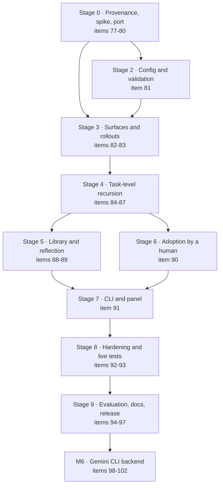

# Execution plan: Harness² recursive self-improvement (M5)

How we build [M5](plan.md#m5--recursive-harness-improvement-rsi), in order, with what to write, how to prove each step, and where a person decides. Item numbers refer to [todo.md](todo.md). Gemini CLI support is deliberately later (M6, items 98 to 102). Design: [architecture.md](architecture.md#recursive-harness-improvement-rsi). Open questions: OQ-11 to OQ-17 in [open-questions.md](open-questions.md).

Source: Harness² ([arXiv:2610.14224](https://arxiv.org/abs/2610.14224), [code](https://github.com/google-research/harness2), Apache-2.0, pinned `1cfe254`).

## Approach

1. **Walking skeleton first.** Get the whole Propose, Probe, Compose loop running end to end with a deterministic fake improver and fake executor before any real model is involved. Then swap in real agents one at a time.
2. **Port and refactor, inside this repo.** The method code becomes `whiletrue.rsi.harness2` (typed to pyright strict, our error and logging conventions, no global state, our test layout), so users install nothing extra and other methods can sit beside it as `whiletrue.rsi.<method>`. Only the method is ported; the orchestration is rebuilt on whiletrue's runtime (items are tasks, pipeline scopes are rollouts, improver sessions are agent steps). Every ported file keeps its Apache header, gains a modification notice and is listed in `third_party/harness2/PROVENANCE.md`.
3. **Off by default, provably.** A regression test runs existing pipelines with and without the `rsi` key present and requires identical runs.
4. **Small commits.** One todo item or a tight group per commit, tests and docs in the same change, `poe check` green, and your explicit approval before each commit and push (and before any tag).
5. **Spend carefully.** Live tests are opt-in (`WHILETRUE_LIVE=1`), use the smallest items, and print their cost. No full runs without a budget you set.

## Dependency graph

Stage 2 (config) and the surface half of Stage 3 only need Stage 0, so they can overlap. The rollout adapter reads the `rsi` config.

## Stage 0 · Provenance and spike (items 77 to 80)

**Goal:** know exactly what we take and prove we can run it.

- **77 (done):** `THIRD_PARTY_NOTICES.md`, `third_party/harness2/{LICENSE,PROVENANCE.md}`, README citation and the license sentence.
- **78 provenance check:** `scripts/check_provenance.py`. `PROVENANCE.md` maps each ported file to its upstream path. The script fails when a file under `whiletrue/rsi/harness2/` lacks the upstream Apache header or a modification notice, or is not listed. It runs inside `poe docs-check` and CI.
- **79 spike (`docs/spike-rsi.md`):** clone the pinned commit into a scratch directory, run `harness2-demo --k 2` (no credentials) and trace one task: reference rollouts, INV and DOM proposals, probes, compositions, selection, reflection. Fill the mapping table (task, domain, harness, rollout, executor, improver) and the Claude Code surface and unsafe list (OQ-16).
- **80 port (`whiletrue/rsi/harness2/`):** `tree.py` and `surfaces.py` (component tree, `SurfaceSpec`), `ledger.py`, `library.py`, `runmark.py`, `selection.py`, `context.py` (evidence tree and leak tripwires), `prompts.py`. Refactor to this repo: typed models, no module globals, our error types, small functions that pass the repo's lint rules, tests in `tests/unit/rsi/harness2/`. Not ported: benchmarks, judge, report, the sweep scheduler, CLI, install and the substrates (our runners replace them).

**Exit:** the ported modules pass their tests and reproduce the upstream budget identity, tree validation and selection behavior; the provenance check is in CI.

## Stage 2 · Config and validation (item 81)

**Goal:** the `rsi` setting exists, validates, plans, and changes nothing when off.

- Pydantic models for `rsi: bool | {k, mode, domain, adopt, evidence, budget_usd, when}` at the top level and in agent headers; precedence agent over top level; `--rsi/--no-rsi` on `run`.
- `validate` rules: budget required, limits on improver and selector agents, `workspace: git-worktree`, an adoption policy.
- `plan`: prints the RSI stages and the worst-case multiplier (R = 4k rollouts, P = 3k improvement sessions) and the worst-case cost from the agents' limits.
- Tests: golden outputs for `validate` and `plan`, and the regression test that every existing example and recipe yields identical plans and runs with the key absent versus `rsi: false`.

**Exit:** `whiletrue plan` shows an RSI-expanded pipeline for a sample config; nothing runs yet.

## Stage 3 · Surfaces and rollouts (items 82 and 83)

**Goal:** read, edit and run a candidate harness in isolation.

- **82 surfaces (`whiletrue/rsi/surface_*.py`):** one `SurfaceSpec` each for Claude Code, opencode and Codex (reuse upstream's). Claude Code maps the eight components to files in the worktree: system prompt (agent file prompt), guardrails (permission settings), memory (`CLAUDE.md`), tool guidance (agent `tools:` and prompt section), subagents (`.claude/agents/`), skills (`.claude/skills/`), scripts, plugins (hooks, MCP). Read, validate, write and diff trees; flag hooks, scripts, permission rules and MCP as always-approve. Tests with golden trees.
- **83 rollout adapter (`rollout.py`):** run the pipeline's agent step under a candidate tree in its own worktree (`git worktree add` from the item's base), collect trajectory (run record events and transcript) and deliverable, and write the completion marker and harness fingerprint so a finished rollout is reused on resume. Tests with the fake executor: isolation (two candidates never share files), reuse on resume, crash mid-rollout.

**Exit:** with a fake executor, a candidate harness is applied, run and recorded in a worktree, then cleaned up.

## Stage 4 · Task-level recursion (items 84 to 87)

**Goal:** Propose, Probe, Compose, select, with the budget identity enforced.

- **84 improver and evidence:** the improver, composer and selector are ordinary whiletrue agent steps (limits, any backend), prompts adapted from `prompts.py`. The evidence tree builder writes task, rollouts, deliverables, current harness and library as files, with the answer-free tripwires (no gate verdicts unless `evidence: gates`). Tests: a planted gate verdict in evidence is rejected.
- **85 `rsi` strategy:** k reference rollouts, k general and k domain proposals, probes, k compositions, final rollouts. Parallel mode uses the scheduler's semaphores and `max_agents`; sequential mode carries the harness and evidence forward. Every stage is journaled and resumable. Tests: golden stage order for both modes at k=1 and k=2, resume after a kill at each stage.
- **86 blind selection:** anonymized finals with a seeded shuffle, selector failure falls back to the base output, optional `selection: gate-first`.
- **87 budget ledger:** check R = 4k and P = 3k at run time, record spend per stage, enforce `rsi.budget_usd` (park the item with a reason), apply the `when:` guard. `cost` splits by stage. Tests: identity violations fail loudly; budget exhaustion parks, never overspends.

**Exit:** the fake-executor demo (ported from `harness2-demo`) runs both modes to a selected output, and the ledger balances.

## Stage 5 · Library and reflection (items 88 and 89)

**Goal:** later items benefit from earlier ones.

- **88 library:** `.whiletrue/rsi/<domain>/` holds adopted harnesses and `EXPERIENCE.md`, read before each item and appended after. Ordered within a domain, concurrent across domains, scoped per run and mode. Domain comes from `rsi.domain`. Tests: ordering, isolation between domains, library read in the evidence tree.
- **89 reflector:** an agent step proposing evidence-supported lessons into `history` and `learnings`; nothing reaches an agent until you approve it (existing `learnings approve`).

## Stage 6 · Adoption by a human (item 90)

**Goal:** you stay accountable for every line.

- `rsi.adopt: approve | auto | never`. On `approve`, the chosen harness diff is shown at a `human.approve` gate (`what: harness`), committed on approval and discarded on `rejected`; your rejection note feeds the next reflection. Hooks, scripts, permission rules and MCP edits never use `auto`.
- Tests: approve commits exactly the diff shown; reject leaves the repo untouched; `auto` refuses unsafe paths.

## Stage 7 · CLI and panel (item 91)

`whiletrue rsi status | diff | library | adopt | reset`; the control panel shows the RSI stage per item; `logs` and `cost` split by stage. Tests via the CLI harness; docs in `cli.md`.

## Stage 8 · Hardening and live tests (items 92 and 93)

- **92:** the fake-executor demo as an integration test; kill and resume at every stage; the `rsi: false` regression suite; coverage floor held or raised.
- **93 (opt-in, spends tokens):** real Claude Code, `k=1`, one tiny item, under a small `budget_usd`. Record cost and wall time in the docs.

## Stage 9 · Evaluation, docs, release (items 94 to 97)

- **94 evaluation:** a small coding backlog (about 6 items, like the tutorial's), run three ways (base, `history.distill` baseline, `rsi`), measuring gate pass rate, retries and cost. Publish the numbers honestly, including a negative result (OQ-17).
- **95 docs:** `docs/rsi.md`, a tutorial section, reference and architecture updates, README feature text (replacing "Roadmap"), CHANGELOG, citation kept in place.
- **96 exit check** and **97 release `v0.2.0`:** version bump, tag, PyPI trusted publishing, as for 0.1.1.

## Decisions to make with you

| # | Decision | When | Default if you say nothing |
|---|---|---|---|
| D1 | Package layout for later RSI methods (OQ-11, decided) | Done | `whiletrue.rsi.<method>`, starting with `whiletrue.rsi.harness2` |
| D2 | Live-test budget (dollars) for Stages 8 and 9 | Stage 8 | $5 total |
| D3 | Whether `evidence: gates` ships in v0.2 (OQ-12) | Stage 4 | Ships as opt-in, off by default |
| D4 | `adopt` default (OQ-14) | Stage 6 | `approve` |
| D5 | A throwaway repo for the real-GitHub run (todo 71) and for the RSI evaluation | Stage 9 | Local `origin` and file-backed GitHub |

## Definition of done for M5

- Every todo item 77 to 96 is ticked with its tests and docs in the same commit.
- `rsi: false` leaves all existing behavior and tests unchanged.
- `poe check` is green with the coverage floor held; the provenance check is in CI.
- The evaluation is published; the README claims only what it shows.
- Notices and the paper citation are in place, no upstream benchmark code or data is copied, and you have reviewed every adopted-harness path and the ported file list.
